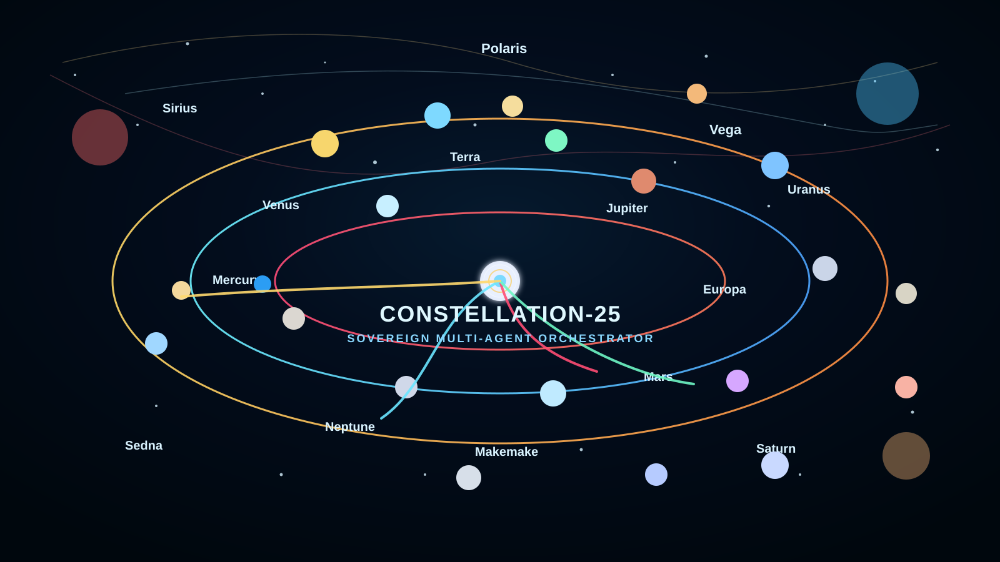

<p align="center">
  
</p>

# Constellation-25

Sovereign AI orchestration platform for autonomous software generation, deployment, monitoring, and secure operations.

A sovereign multi-agent orchestration platform for autonomous software generation, CI/CD execution, local-first deployment, and secure operational coordination across edge, mobile, and cloud environments.

## Overview

Constellation-25 coordinates 25 specialized AI agents to manage the software lifecycle from planning to deployment and observability. Built for sovereign execution, the platform is designed to run locally on mobile and edge environments while integrating with GitHub, deployment targets, and production monitoring systems.

## Why Constellation-25

- Local-first, sovereign runtime design
- Multi-agent orchestration across specialized domains
- Secure, policy-driven execution for critical operations
- GitHub and deployment automation
- Production monitoring, rollback, and operational resilience

## Quickstart

```bash
git clone https://github.com/FacePrintPay/constellation25.git
cd constellation25
cp .env.example .env
npm install
make run
```

## Documentation

- [Architecture](docs/architecture.md)
- [Deployment Runbook](docs/runbook.md)
- [FAQs](docs/faqs.md)
- [Licenses and Attributions](docs/licenses-and-attributions.md)
- [Agent Command Cheat Sheet](docs/agent-command-cheatsheet.md)

## Deployment

Constellation-25 is designed for sovereign, local-first execution with optional cloud deployment targets. This section defines the production deployment workflow for validating, shipping, monitoring, and rolling back releases safely.

### Deployment Overview

Deployments should follow a controlled, policy-gated lifecycle:

1. Prepare the release branch and confirm repo state
2. Validate environment configuration and secrets
3. Run linting, tests, and build checks
4. Promote the build to staging or production
5. Verify service health and runtime metrics
6. Keep rollback instructions ready for immediate execution

### Prerequisites

Before deploying to a production environment, confirm the following:

- the target branch is correct and up to date
- `.env` or equivalent environment configuration is populated
- secrets are stored securely and not committed to the repository
- required infrastructure dependencies are reachable
- build and deployment credentials are valid
- monitoring and alerting are enabled
- rollback procedures have been reviewed

### Production Deployment Checklist

Use this checklist before every release:

- [ ] Repository is clean and branch is verified
- [ ] Dependency versions are pinned or intentionally approved
- [ ] Required environment variables are loaded
- [ ] Security checks have passed
- [ ] Unit and integration tests in CI are green
- [ ] Build artifacts have been generated successfully
- [ ] Release notes and rollback steps are documented
- [ ] Deployment window is approved for production

### Build and Validation

```bash
git fetch --all --prune
git checkout <release-branch>
git pull --ff-only origin <release-branch>

make lint
make test
make build
```

### Deployment Commands

```bash
make deploy
```

For Docker-based deployments:

```bash
docker compose up -d
```

### Post-Deployment Validation

```bash
curl -f http://localhost:PORT/health || true
curl -f http://localhost:PORT/ready || true
```

### Rollback

```bash
git revert <release-commit>
make rollback
```

### Security Requirements

Before production release, verify:

- secrets are not hardcoded
- no debug flags are enabled
- environment isolation is preserved
- deployment credentials are scoped correctly
- log output does not expose sensitive values
- biometric or policy validation is enforced for protected operations

### Deployment Sign-Off

A production deployment is considered complete only when:

- automated checks pass
- health validation succeeds
- monitoring confirms stable runtime behavior
- rollback is verified and documented
- release notes and ownership are recorded

## Key Features

- Local-first and edge-friendly execution
- Biometric and policy-based security
- GitHub and deployment automation
- Multi-agent orchestration
- CI/CD and build orchestration
- Observability and alerting

## Repository Layout

```text
constellation25/
├── agents/
├── api/
├── cli/
├── core/
├── integrations/
├── docs/
├── monitoring/
├── security/
├── scripts/
├── tests/
├── README.md
├── LICENSE
├── .env.example
├── Dockerfile
├── docker-compose.yml
└── Makefile
```

## Production Notes

- Treat security gates as mandatory for production operations.
- Keep agent responsibilities isolated and explicit.
- Persist task and deployment state for traceability.
- Validate all external integrations before release.

## License

See `LICENSE` for project licensing details and refer to [`docs/licenses-and-attributions.md`](docs/licenses-and-attributions.md) for attribution guidance.
